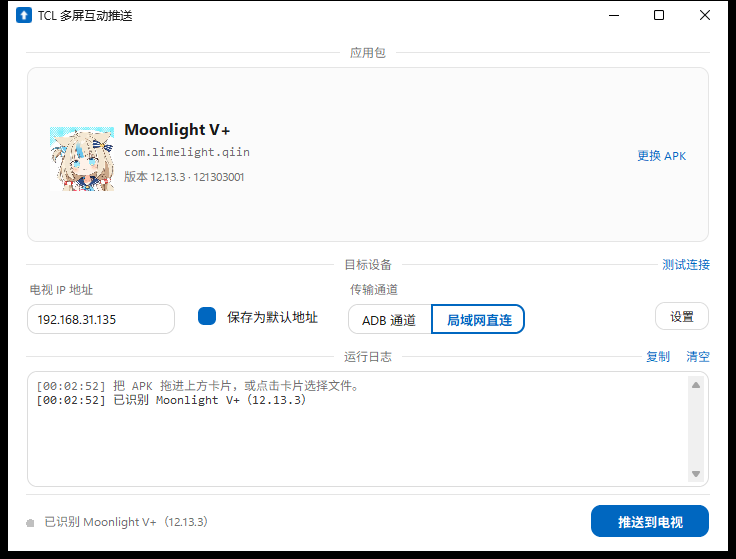
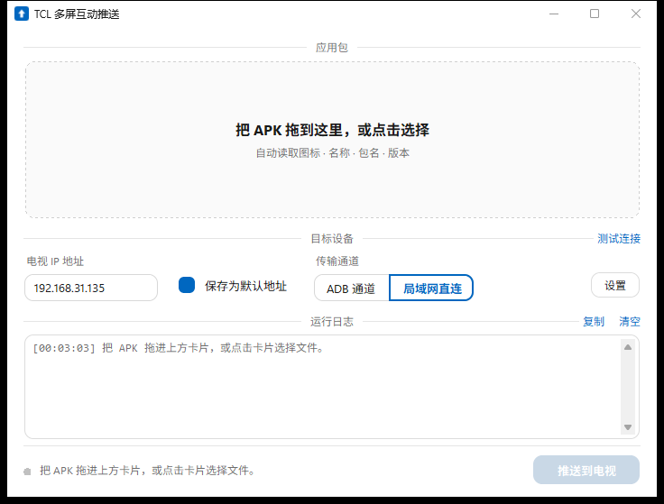
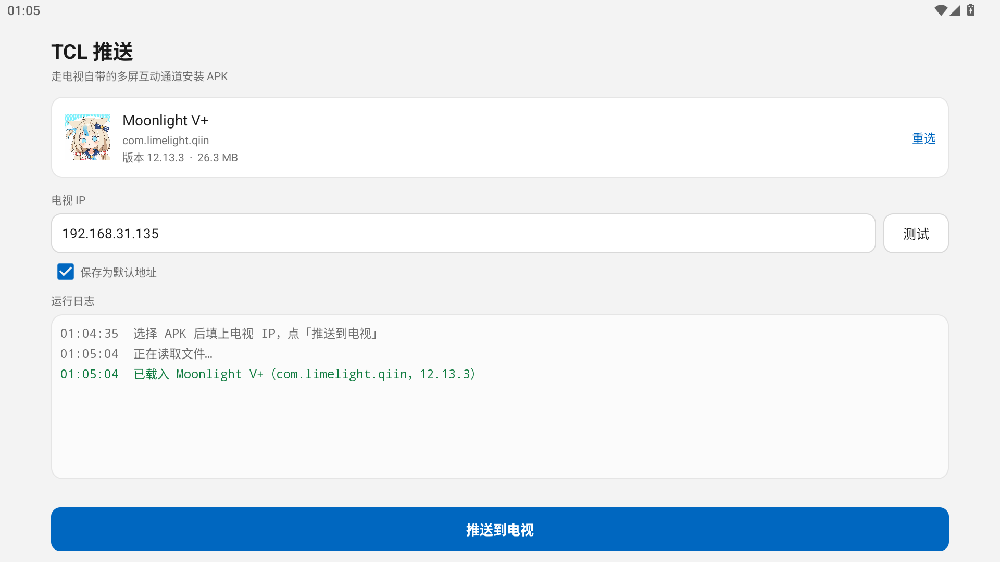
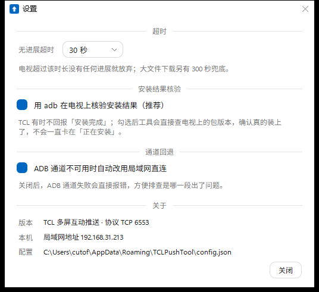

# TCL 多屏互动推送

> 往 TCL / 雷鸟电视里装 APK 的小工具。拖进文件、点一下，走电视自带的「多屏互动」通道送过去 —— 不用开 adb 调试，也不会被固件的安装校验拦下来。

<p>    
    
    
    
    
    
</p>



## 目录

- [为什么需要它](#为什么需要它)
- [特性](#特性)
- [两个版本](#两个版本)
- [快速开始](#快速开始)
- [使用](#使用)
- [工作原理](#工作原理)
- [设置项](#设置项)
- [从源码构建](#从源码构建)
- [项目结构](#项目结构)
- [兼容性与实测](#兼容性与实测)
- [常见问题](#常见问题)
- [已知限制](#已知限制)
- [免责声明](#免责声明)
- [License](#license)

## 为什么需要它

TCL 电视的固件对 `adb install` 做了拦截，直接装会返回：

```
Failure [INSTALL_FAILED_VERIFICATION_FAILURE]
```

同一台电视上 `adb push` 正常、从 shell 里执行 `pm install` 也被拦。**能装包的现成路径是电视自带的「多屏互动」**（`com.tcl.MultiScreenInteraction_TV`）—— 就是手机投屏、文件互传那个功能。它走一条私有 TCP 协议，自己下载 APK 再调用系统安装器，绕过了 adb 的校验。

这个工具把那套协议封成了图形程序：不用再开手机 App、不用在电视上翻文件目录、装完还能告诉你到底装上了没有。

## 特性

**拖进来就认识**

把 APK 拖到窗口里，包名、版本号、应用名、图标一次性读出来。纯 Python 解析二进制 `AndroidManifest.xml` 和 `resources.arsc`，**不依赖 aapt / apktool**，单文件就能跑。

**两种传输通道**

| 通道     | 原理                                             | 适用                                      |
| ------ | ---------------------------------------------- | --------------------------------------- |
| ADB 通道 | `adb reverse tcp:18765` 把电视的 `127.0.0.1` 打洞回电脑 | 电视已开 USB / 网络调试并授权，**不受 Windows 防火墙影响** |
| 局域网直连  | 电脑起 HTTP 服务，电视按局域网 IP 来取                       | 电视没开 adb，或 adb 授权过期                     |

ADB 通道不可用时会自动回退到局域网直连（可在设置里关掉），日志会写清是哪一步出的问题。

*部分功能依赖ADB，需手动打开。打开方式： 设置 → 关于 → 本机信息，快速按遥控器「上下左右」，在底部的「更多」里打开 ADB

**自动检查装没装上**

电视一进入安装阶段，每 2 秒用 `dumpsys package` 查一次实际落地情况，用 `versionName` + `lastUpdateTime` 双重比对。已经装着同版本时，必须看到 `lastUpdateTime` 变化才算成功，避免「本来就有」被误判成「刚装好」。

30 秒没有任何进展就放弃（可调 15–90 秒），另有大文件兜底的硬超时。推送按钮在运行中变成「停止」，随时可以中止。

**其它**

- 电视 IP 记一次，勾选「保存为默认地址」下次直接用
- 「测试连接」一眼看出端口通不通、adb 授权还在不在
- 日志区可复制、可清空，出错原因用人话写
- 界面自绘抗锯齿圆角

## 两个版本

|        | Windows 版（根目录）   | Android 版（[`android/`](android/)） |
| ------ | ---------------- | --------------------------------- |
| 形态     | 单文件 exe，约 17 MB  | 单文件 APK，约 50 KB                   |
| 适合     | 电脑在手边，装包多、要结果确定  | 不想开电脑，手机直接推                       |
| 传输通道   | ADB 通道 + 局域网直连   | 局域网直连                             |
| 安装结果核验 | 有，用 `dumpsys` 反查 | 无，只能以电视回传为准                       |
| 解析 APK | 自己解 AXML / ARSC  | 调 `PackageManager`                |
| 运行时    | 无依赖，免安装          | Android 7.0+，零第三方库                |

<table>    
<tr>    
<td></td>    
<td></td>    
</tr>    
<tr>    
<td align="center">桌面版空态</td>    
<td align="center">手机版</td>    
</tr>    
</table>

手机版细节见 [android/README.md](android/README.md)。

## 快速开始

**开箱即用**：从 [Releases](../../releases) 下载 `TCL多屏互动推送.exe`，双击运行。单文件、免安装、不写注册表，配置只落在 `%APPDATA%\TCLPushTool\config.json`。

**从源码跑**：

```bash
git clone <this-repo>
cd tcl-push
python tcl_push.py
```

只需要 Python 3.8+ 和自带的 `tkinter`。装了 `tkinterdnd2` 才会启用拖拽，没装不影响运行，点卡片选文件一样用。

## 使用

1. 电视和电脑连同一个 Wi-Fi，电视上打开「多屏互动」（部分机型藏在「我的应用」里，或叫「投屏」）
2. 填电视 IP，例如 `192.168.1.100`，勾上「保存为默认地址」
3. 把 APK 拖进上方卡片，或点卡片选择文件 —— 确认显示的应用名、包名、版本对得上
4. 选通道：电视开了 adb 调试就选「ADB 通道」，否则选「局域网直连」
5. 点「推送到电视」
6. **电视会弹确认框：按遥控器「右」选中「同意」，再按确认** ← 这一步不做，推送会卡在等待

装好后日志会显示 `安装完成 ✔ 包名 版本`。

## 工作原理

### 协议

TCP 连电视的 **6553** 端口。每条消息是 **4 字节大端长度前缀 + UTF-8 正文**，正文里的字段再用 `>>` 分隔 —— 不是按行读，必须按长度切帧，否则收到的永远是半条消息。

```
电脑 → 电视   159>>1>>0                                    建立会话
电脑 → 电视   223>>INSTALL>>包名>>应用名>>下载地址>>2>>
              versionCode>>体积MB>>>>>>>md5(下载地址)      投递安装任务
电视 → 电脑   223>>INSTALL>>包名>>应用名>>confirm_pending   等用户确认
电视 → 电脑   223>>PROGRESS>>包名>>应用名>>1>>百分比        下载中
电视 → 电脑   223>>PROGRESS>>包名>>应用名>>3>>百分比        安装中
电视 → 电脑   223>>PROGRESS>>包名>>应用名>>5>>百分比        完成
电视 → 电脑   223>>INSTALL>>包名>>应用名>>denied            用户拒绝
电脑 → 电视   150>>                                        每 5 秒心跳
```

`PROGRESS` 的第 5 段是阶段码：`1` 下载、`3` 安装、`5` 完成、`2` 失败。包名对不上的一律忽略，避免串消息。

### 点对点取包

电视是主动来 **下载** 的，所以电脑这边要能提供一个地址：

- 局域网直连：`ThreadingHTTPServer` 监听随机端口，地址取本机内网 IP
- ADB 通道：只监听 `127.0.0.1:18765`，再用 `adb reverse` 把这个端口映射到电视上，电视访问 `http://127.0.0.1:18765/app.apk` 就落到电脑上 —— 全程不经过外部网络，防火墙也管不着

服务端记录是否真的有人来取过文件。如果全程没人连进来，超时信息后面会补一句「电视没能从电脑取到文件，检查防火墙」，省得你对着「超时」两字瞎猜。

### 结果核验

```
dumpsys package <包名> | grep -E 'versionName|lastUpdateTime'
```

推送前先记一份快照，安装阶段开始后每 2 秒比对一次：

- 之前没装过 → 现在查到了 = 成功
- 之前装过旧版 → 指纹变了 = 成功
- 之前就是同版本 → 必须 `lastUpdateTime` 变化才算成功

### 内网 IP 的选择

多网卡机器上（尤其装了代理软件，会凭空多出 `198.18.0.1` 这种虚拟网卡）很容易把地址给错，电视根本连不上。这里枚举所有候选地址再打分：`192.168.x.x` 优先，`10.x` / `172.16-31.x` 次之，`198.18/19`、`127.x`、`169.254.x` 直接排除。

## 设置项

| 项      | 默认   | 说明                                    |
| ------ | ---- | ------------------------------------- |
| 无进展超时  | 30 秒 | 电视多久没有任何进展就放弃（15 / 30 / 45 / 60 / 90） |
| 安装结果核验 | 开    | 安装阶段用 adb 在电视上核实结果，不依赖电视回传完成          |
| 通道回退   | 开    | ADB 通道不可用时自动改用局域网直连                   |

配置文件：`%APPDATA%\TCLPushTool\config.json`



## 从源码构建

### Windows 版

界面用 Python 自带的 `tkinter`，没有运行时依赖。构建带拖拽的版本需要 `tkinterdnd2`，打包需要 `pyinstaller`：

```bash
pip install pyinstaller tkinterdnd2
pyinstaller TCL多屏互动推送.spec
```

产物在 `dist/`，约 17 MB。仓库里的 `adb/` 需要你自己放 platform-tools 的 `adb.exe` 与 `AdbWinApi.dll`（见 [adb/README.md](adb/README.md)），打包时会被一起塞进 exe，目标机器不用另装 adb。

等价的手写命令：

```bat
pyinstaller --noconfirm --onefile --windowed ^
  --name "TCL多屏互动推送" --icon "app.ico" ^
  --collect-all tkinterdnd2 ^
  --add-data "adb;adb" --add-data "app.ico;." ^
  --exclude-module numpy --exclude-module PIL ^
  tcl_push.py
```

### Android 版

不依赖 Gradle，一个脚本走完 aapt2 → javac → d8 → zipalign → apksigner：

```bash
cd android
ANDROID_SDK=/path/to/android-sdk bash build.sh
```

需要 `build-tools`（aapt2 / d8 / zipalign / apksigner）和 `platforms/android-34/android.jar`。首次构建会在 `keystore/` 下生成自签名密钥（口令默认 `tclpush`，可用 `KS_PASS` 覆盖），密钥不入库。

协议层不引用任何 Android API，可以在 PC 上回归：

```bash
cd android && bash tools/run_tests.sh
```

`tools/fake_tv.py` 是一台假电视，按真实报文格式回话，覆盖正常安装 / 拒绝 / 失败 / 超时 / 串消息 / 中途停止六个分支。

## 项目结构

```
.
├── tcl_push.py              # Windows 版主程序：解析 / 协议 / 通道 / 界面
├── TCL多屏互动推送.spec      # PyInstaller 打包配置
├── app.ico                  # 应用图标
├── adb/                     # 放 platform-tools（二进制不入库）
├── docs/images/             # README 截图
├── tools/
│   └── screenshot_window.py # 开发期截图工具（PrintWindow + GDI）
└── android/                 # 手机版：纯 Java + 手写构建脚本
    ├── src/com/hamenot/tclpush/
    ├── res/
    ├── build.sh
    └── tools/               # 假电视 + 命令行客户端 + 回归脚本
```

## 兼容性与实测

| 项目 | 说明                                                  |
| -- | --------------------------------------------------- |
| 电视 | TCL（`tcl_mt5879_cn`），Android 11，固件自带「多屏互动」          |
| 电脑 | Windows 11 x64，Python 3.12                          |
| 手机 | Android 7.0+（minSdk 24），模拟器验证于 MuMu 12 / Android 15 |

验证过的场景：第三方 APK 完整推送安装、同版本重装、电视上选择拒绝、包名不匹配的串消息过滤、adb 未授权时自动回退、推送中途手动停止、自定义超时。

## 常见问题

**电视上选了「拒绝」，能重来吗**

可以，重新推送即可。日志里会写 `电视上选择了拒绝，已取消`。

**一直卡在「正在安装」**

先确认设置里的「安装结果核验」是开着的，并且电视开了 adb 调试。核验走的是 `dumpsys package`，adb 不通就退化成只能等电视回传。

**提示「电视没能从电脑取到文件」**

电视没连上电脑的 HTTP 服务。多半是 Windows 防火墙拦了 —— 换「ADB 通道」可以完全绕开；或者第一次运行时在防火墙弹窗里勾上「专用网络」并允许。

**IP 明明填对了，还是连不上**

电视上的「多屏互动」要处于打开状态，这个端口才会监听。可以先点「测试连接」看端口返回什么。

**推送成功但电视里找不到图标**

部分机型的电视桌面不会自动刷新，重启电视或在应用列表里下拉刷新一下。

更多问题见 [Issues](../../issues)。

## 已知限制

- 只支持 TCL / 雷鸟电视的「多屏互动」实现（`com.tcl.MultiScreenInteraction_TV`，端口 6553）。其它品牌各有各的协议，不通用
- 部分固件版本已经把 6553 关掉或改了鉴权，那就只能走 adb 的老路（如果没被拦）
- 应用名 / 图标的解析覆盖常见的 AXML 与 ARSC 结构，遇到非常规打包方式（例如资源全混淆）会退化成显示包名
- 桌面版仅 Windows。界面用了 DWM 的圆角与深色标题栏属性，Windows 10 上会自动退回直角
- 手机版没有 adb 核验能力，电视不回最终状态时只能提示「可能已经装好，去应用列表确认」

## 免责声明

只在**你自己拥有或有权管理**的设备上使用。这套协议是电视固件自带的、用于接收安装包的通道，本工具没有绕过任何加密或签名校验，但它确实会往电视上装软件 —— 装什么、装到谁的电视上，由使用者负责。

本项目与 TCL 无关联，未获得其授权或认可。

## License

[MIT](LICENSE) —— 自由使用、修改、分发，保留版权声明即可。
