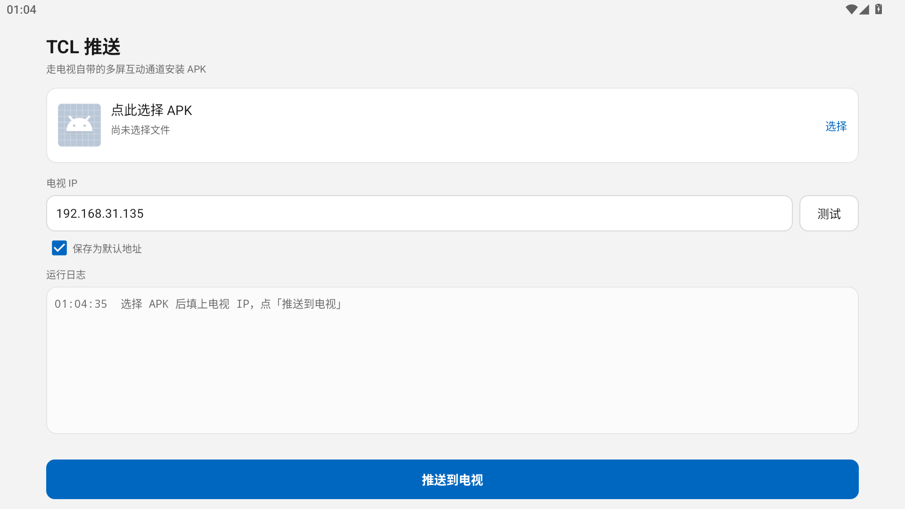

# TCL 推送 · Android 版

> Windows 版的手机孪生体：选一个 APK，通过电视自带的「多屏互动」通道推过去。不用开电脑，也不用电视开 adb。

同一套协议（TCP 6553 的 `223>>INSTALL`），同一套报文格式，核心代码是从 `tcl_push.py` 逐行移植过来的 Java 版本。区别只在传输通道：手机上跑不了 adb，所以固定走局域网直连 —— 手机起一个 HTTP 服务，把内网地址报给电视，电视自己来下载。

<p>  
  
  
</p>

> 桌面版（Windows）见[仓库根目录的 README](../README.md)。

## 和 Windows 版的差别

|          | Windows 版                   | Android 版                                |
| -------- | --------------------------- | ---------------------------------------- |
| ADB 通道   | 支持，`adb reverse` 打洞，不受防火墙影响 | 不支持（手机上没有 adbd 客户端）                      |
| 局域网直连    | 支持                          | **唯一通道**                                 |
| 安装结果核验   | 用 `adb dumpsys` 反查，结果可信     | 没有，只能以电视回传为准                             |
| 选择文件     | 拖拽或点击                       | 系统文件选择器（SAF），无需存储权限                      |
| APK 信息解析 | 自己解 AXML / ARSC             | 调 `PackageManager.getPackageArchiveInfo` |
| 依赖       | PyInstaller 打包 adb          | 纯 Java，零第三方库                             |

少了 adb 核验是真实的降级：电视如果一直不回完成状态，只能提示「可能已经装好，去应用列表确认」。

## 使用

1. 手机和电视连**同一个 Wi-Fi**
2. 电视上打开「多屏互动」
3. 填电视 IP，勾「保存为默认地址」
4. 点卡片选 APK，确认应用名和版本对得上
5. 点「推送到电视」，电视弹框时按遥控器「右」选中「同意」再确认

推送期间请保持这个页面在前台 —— 后台被杀会中断传输。

## 构建

不依赖 Gradle，一个 shell 脚本走完 aapt2 → javac → d8 → zipalign → apksigner：

```bash
bash build.sh
```

产物：`dist/TCL推送.apk`（约 50 KB）。

脚本按 `ANDROID_SDK` → `ANDROID_HOME` → `ANDROID_SDK_ROOT` 的顺序找 SDK，都没有则回落到 `%LOCALAPPDATA%/Android/Sdk`，换机器时用环境变量指过去：

```bash
ANDROID_SDK=/path/to/android-sdk JAVA_HOME=/path/to/jdk17 bash build.sh
```

需要 `build-tools`（aapt2 / d8 / zipalign / apksigner）和 `platforms/android-34/android.jar`。首次构建会生成 `keystore/tclpush.jks`（口令默认 `tclpush`，用 `KS_PASS` 可覆盖），之后复用它签名；想换签名就删掉这个文件重新构建。**密钥不入库**，已在 `.gitignore` 里排除。

## 协议回归

核心三个类（`PushCore` / `ApkServer` / `NetUtil`）不引用任何 Android API，所以能在 PC 上直接跑：

```bash
bash tools/run_tests.sh
```

`tools/fake_tv.py` 是一台假电视，按真实报文格式回话，`tools/PushCli.java` 是命令行客户端。覆盖六个分支：

| 场景          | 期望                                   |
| ----------- | ------------------------------------ |
| 正常安装        | `ok`，阶段 confirm → download → install |
| 用户在电视上拒绝    | `denied`                             |
| 电视报告下载/安装失败 | `failed`                             |
| 进入安装阶段后不再回话 | `timeout`（按「无进展」计时）                  |
| 冒出别的包名的完成消息 | 仍为 `ok`，说明串消息被过滤掉                    |
| 中途点停止       | `stopped`                            |

假电视还会校验 `INSTALL` 报文的 12 个字段、体积是否向上取整、以及心跳有没有按时到。

## 已知限制

- 手机必须和电视在同一网段；路由器开了「AP 隔离」时电视连不到手机的 HTTP 服务
- 用移动数据时本机地址不是内网段，程序会直接拦下来提示先连 Wi-Fi
- 电视不回最终状态时无法像 Windows 版那样反查结果
- 界面按手机竖屏设计；投到电视上能显示，但不好操作

## 在模拟器上验证过什么

在 MuMu 12（Android 15，1080×1920，dpi 280）上实跑：

| 项目             | 结果                                                             |
| -------------- | -------------------------------------------------------------- |
| 安装 / 启动        | 通过，冷启动 383 ms，logcat 无异常                                       |
| 系统文件选择器选 APK   | 通过，与 Windows 版解析结果一致（`com.limelight.qiin` / 12.13.3 / 26.3 MB） |
| 应用图标与名称        | 由 `PackageManager` 取出，显示正常                                     |
| 勾选「保存为默认地址」后重启 | 通过，IP 与勾选状态都保留                                                 |
| 推送流程（电视离线）     | 4 秒内报「连不上 x:6553」，并给出排查提示                                      |
| 协议层            | 在 PC 上用假电视跑 6 个分支，见上一节                                         |

界面没在真机手机上验证过（模拟器是横屏平板形态），竖屏下的比例只能靠 `values-sw600dp` 之外的默认值保证。
